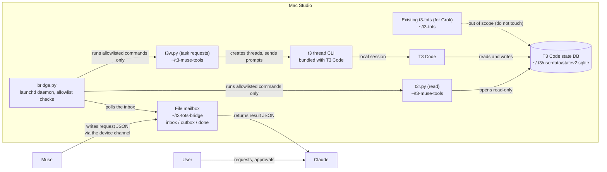

# t3-muse

English | [日本語](README.ja.md)

A companion for working with T3 Code from Meta Muse. Built
incrementally and from scratch: each piece is added only when it is
actually needed.

## Architecture

Key points:

- There is no path for the Mac to actively connect to Muse. Muse
  places and fetches files through its device channel — a file mailbox.
- The bridge listens on no network port and runs nothing outside its
  allowlist (`bridge-ping`, the read-only `t3r.py` commands, and the
  task-request `t3w.py` commands).
- Direct database access is read-only. Task requests to T3 go only
  through T3 Code's own CLI (`t3w.py`), and only for requests the user
  actually asked Muse to make.
- The existing Grok-side t3-tots setup (`~/t3-tots`) runs on the same
  Mac but is out of scope for this project.

Development flow: branch → pull request → CI (GitHub Actions) →
squash merge. Files under `.github/workflows/` are the one exception:
the Muse GitHub App cannot push them, so they go through a dedicated
PAT instead.

## Layout

| Path | Contents |
|---|---|
| `bridge/` | The always-on Mac bridge. Receives requests through the file mailbox over Muse's device channel and runs allowlisted commands only (design notes in `bridge/README.md`) |
| `tools/` | Our own Mac-side tools. `t3r.py` is a minimal read-only reader for T3 Code's state database (`schema` / `health` / `status`). `t3w.py` sends task requests through T3's bundled `t3 thread` CLI (`start` / `send` / `show` / `list`) |

## How development proceeds

- First, get the bridge running on the Mac Studio and verify
  connectivity (bridge-ping)
- Then open the minimal read-only path
- Write skills one at a time, as they become necessary, matched to
  how the system actually behaves
