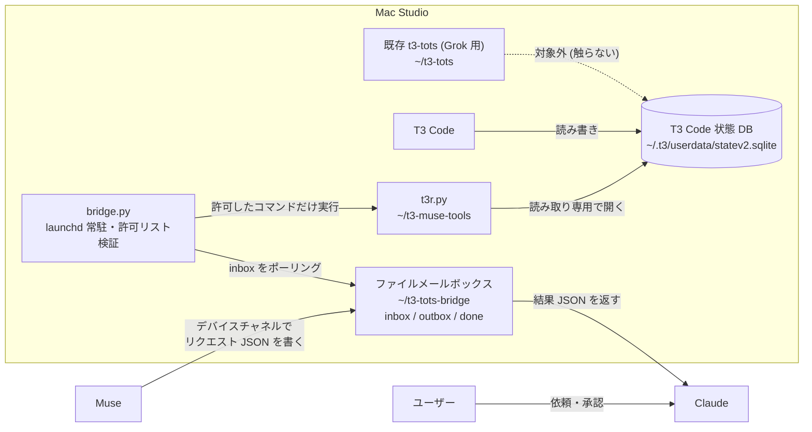

# t3-muse

T3 Code を Meta Muse から扱うためのコンパニオン。必要なものを、
実際に要るものから1つずつ自前で実装していくリポジトリ。

## 構成図

要点:

- Mac から Muse へ能動的に接続する経路はない。Muse がデバイスチャネル経由でファイルを置きに・取りに行く (メールボックス方式)
- ブリッジはネットワークを待ち受けず、許可リスト (`bridge-ping` と `t3r.py` の読み取り系サブコマンド) 以外は実行しない
- DB へのアクセスは読み取り専用のみ。書き込みは行わない
- 既存の Grok 用 t3-tots 環境 (`~/t3-tots`) は同じ Mac で稼働しているが、本プロジェクトの対象外

開発フロー: 変更はブランチ → PR → CI (GitHub Actions) → squash マージ。
`.github/workflows/` のファイルだけは Muse の GitHub App の権限外のため、専用 PAT 経由で push する。

## 現在の構成

| パス | 内容 |
|---|---|
| `bridge/` | Mac 常駐ブリッジ。Muse のデバイスチャネル経由のファイルメールボックスで、許可リストのコマンドだけを実行する (設計は `bridge/README.md`) |
| `tools/` | Mac 側の自前ツール群。`t3r.py` は T3 Code の状態 DB を読み取り専用で引く最小リーダー (`schema` / `health` / `status`) |

## 開発の進め方

- まずブリッジを Mac Studio で動かし、疎通 (bridge-ping) を確認する
- 次に読み取り専用の最小経路を通す
- スキルは必要になったものから、実動作に合わせて1つずつ書く
